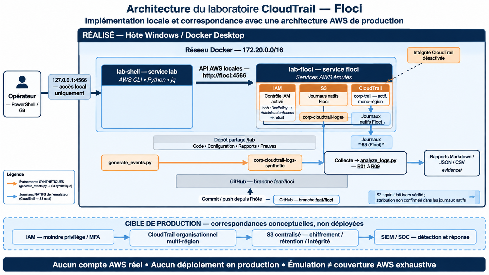
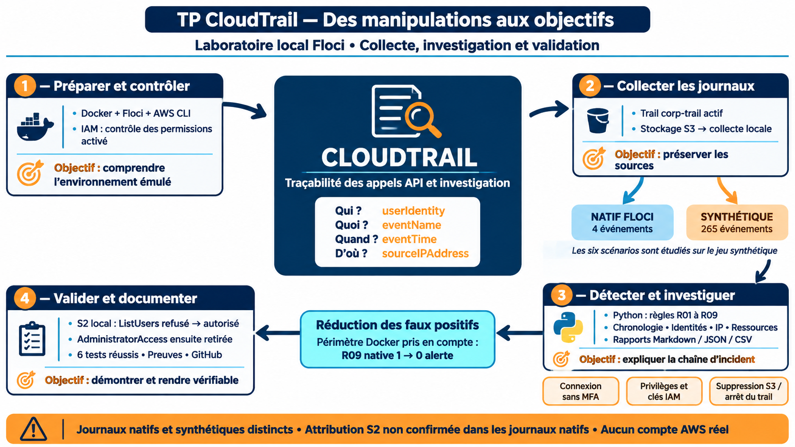

# Investigation CloudTrail en environnement local avec Floci

Projet pédagogique de sécurité cloud : collecte, analyse et investigation d’événements au format AWS CloudTrail, dans un environnement Docker local sans compte AWS réel.

Auteur : ABIDI Othmane

## Vue d’ensemble de l’architecture



Le laboratoire s’exécute localement sous Docker. Le schéma distingue les composants utilisés, les flux de collecte et d’analyse, ainsi que les correspondances conceptuelles avec une architecture AWS de production.

La zone « cible de production » est une proposition d’architecture : elle ne représente pas des services effectivement déployés dans ce projet.

## Manipulations et objectifs du TP



CloudTrail constitue le fil conducteur du TP : comprendre les traces d’appels API, collecter les journaux, corréler les événements et expliquer les actions sensibles.

Les événements synthétiques servent à l’investigation des six scénarios. Les journaux natifs de Floci sont étudiés séparément. Le test IAM local S2 démontre un gain effectif de permissions, mais sa journalisation native n’a pas été confirmée par les preuves examinées.


## Objectifs

- Construire une chronologie à partir d’événements CloudTrail.
- Identifier des actions sensibles et corréler les identités, IP et ressources.
- Analyser six scénarios avec neuf règles de détection Python.
- Distinguer les événements synthétiques des journaux natifs de l’émulateur.
- Vérifier localement une augmentation effective de permissions IAM.
- Documenter les preuves, les limites et les mesures correctives proposées.

## Nature des données et limites

| Élément | Nature |
|---|---|
| Docker, AWS CLI, Python et fichiers de preuve | Outils et artefacts utilisés localement |
| Services S3, IAM et CloudTrail de Floci | Services AWS émulés, pas les services AWS réels |
| Données produites par `src/generate_events.py` | Événements synthétiques portant la mention `_lab_notice` |
| Journaux natifs de Floci | Source distincte, collectée et analysée séparément |
| Chaîne d’incident du rapport d’investigation | Reconstitution à partir des événements synthétiques |
| Test local S2 | Manipulation IAM exécutée contre Floci |

Les résultats observés dans Floci ne constituent pas une validation exhaustive du comportement d’AWS.

## Environnement

- Hôte Windows avec Docker Desktop et Docker Compose.
- Service `floci`, conteneur `lab-floci`.
- Service de travail `lab`, conteneur `lab-shell`.
- Point d’accès côté hôte : `http://127.0.0.1:4566`.
- Point d’accès depuis le conteneur de travail : `http://floci:4566`.
- Application des autorisations IAM activée avec
  `FLOCI_SERVICES_IAM_ENFORCEMENT_ENABLED=true`.

La version Floci 2.5.0 a été observée pendant les manipulations.
La configuration utilise toutefois `floci/floci:latest` par défaut :
elle ne garantit donc pas de retrouver cette version lors d’un téléchargement ultérieur.

Les identifiants `test/test` sont factices et réservés au laboratoire.
Ne jamais utiliser d’identifiants AWS réels dans ce projet.

## Démarrage

Les commandes suivantes décrivent une initialisation du laboratoire.
Elles ne sont pas nécessaires pour consulter les rapports déjà conservés.

Depuis PowerShell, à la racine du dépôt :

```powershell
Copy-Item .env.example .env
docker compose up -d --build
docker compose ps
docker compose exec lab bash
```

Si `.env` existe déjà, conserver sa configuration plutôt que le remplacer.

Dans le conteneur de travail :

```bash
bash scripts/00_check_env.sh
bash scripts/01_init_aws_local.sh
python src/generate_events.py
bash scripts/03_upload_logs.sh
bash scripts/04_collect_and_analyze.sh
```

La génération et l’analyse peuvent remplacer des sorties existantes.
Préserver les preuves et rapports à conserver avant de relancer la chaîne.

Les commandes ci-dessus concernent le jeu synthétique ; elles ne décrivent pas à elles seules la configuration et la collecte du trail natif.

## Scénarios synthétiques

| Scénario | Actions principales | Règles |
|---|---|---|
| S1 — Création de clé pour une autre identité | `CreateAccessKey`, puis usage de la clé | R03 |
| S2 — Auto-attribution de privilèges | `AttachUserPolicy` avec `AdministratorAccess` | R02 |
| S3 — Suppression du bucket de sauvegardes | `DeleteBucket` | R04 |
| S4 — Altération de la journalisation | `DeleteTrail`, `StopLogging`, reprise et interruption de visibilité | R05, R08 |
| S5 — Connexion suspecte | Échecs suivis d’un succès sans MFA | R01, R07 |
| S6 — Appels refusés rapprochés | Plusieurs opérations en `AccessDenied` | R06 |

Le jeu contient également des cas bénins afin d’étudier les faux positifs.

## Résultat du test local S2

Avec l’application des autorisations IAM activée dans Floci :

1. Bob dispose initialement de `DevPolicy` et reçoit `AccessDenied` sur `ListUsers` : code 255.
2. L’attribution d’`AdministratorAccess` exécutée sous bob réussit : code 0.
3. Le même appel `ListUsers` réussit ensuite : code 0.
4. L’opérateur détache ensuite `AdministratorAccess` : code 0.
5. La liste des policies attachées après nettoyage ne contient plus que `DevPolicy`.

Cette séquence démontre un gain effectif de permissions dans le laboratoire, vérifié sur `iam:ListUsers`.

Le nouveau refus de `ListUsers` après nettoyage n’a pas été vérifié :
la fonction de session `aws_bob` n’était plus disponible.

Les recherches CloudTrail enregistrées sont vides dans les deux régions examinées.
L’unique objet natif listé dans les preuves est antérieur au test.
La journalisation native de l’attribution n’est donc pas confirmée par les éléments examinés.

Les fichiers correspondants sont regroupés dans `evidence/scenarios/S2/`.
Aucune clé secrète n’est nécessaire à la compréhension de ces preuves.

## Organisation

| Chemin | Contenu |
|---|---|
| `docker-compose.yml`, `Dockerfile` | Environnement local |
| `scripts/` | Vérification, initialisation, activité, upload et analyse |
| `src/generate_events.py` | Générateur d’événements synthétiques |
| `src/analyze_logs.py` | Analyseur et règles R01 à R09 |
| `config/dev-policy.json` | Policy volontairement trop permissive du laboratoire |
| `tests/` | Tests automatisés |
| `Compte Rendu/rapport_investigation.md` | Investigation de la chaîne synthétique |
| `Compte Rendu/reponses_questions.md` | Réponses techniques Q1 à Q31 ; Q15 non réalisée |
| `reports/analysis_report.md` | Rapport généré sur le jeu synthétique |
| `reports/findings.json`, `reports/findings.csv` | Alertes exportées |
| `reports/native/` | Analyse initiale des journaux natifs |
| `reports/native-tuned/` | Analyse avec périmètre réseau adapté |
| `evidence/native/` | Configuration et éléments de preuve natifs |
| `evidence/scenarios/S2/` | Preuves du test IAM local et du nettoyage |

Les données générées sous `data/` sont ignorées par Git.

## Analyse des journaux natifs

Un fichier contenant quatre événements natifs a été analysé.
L’analyse initiale a produit une alerte R09 MEDIUM liée à l’IP Docker `172.20.0.3`.

Le sous-réseau Docker ayant été vérifié comme `172.20.0.0/16`,
une analyse distincte a été réalisée avec :

```text
198.51.100.0/24,10.0.0.0/8,172.20.0.0/16
```

Cette analyse adaptée ne produit plus d’alerte sur l’échantillon examiné.
Ce résultat illustre l’importance du périmètre réseau ; il ne prouve pas l’absence générale d’activité suspecte.

## Tests

Depuis le conteneur de travail :

```bash
python -m unittest discover -s tests -v
```

Le statut de la dernière exécution doit être vérifié dans la sortie des tests.
La réussite des tests automatisés ne remplace pas la validation des manipulations contre Floci.

## Précautions

- Ne pas exposer le laboratoire sur un réseau public.
- Ne pas publier `.env`, des secrets ou des clés d’accès.
- Ne pas présenter les événements synthétiques comme les traces d’un incident réel.
- Ne pas confondre retrait d’une policy et correction de la policy initiale : `DevPolicy` reste volontairement permissive pour le TP.
- Ne pas exécuter de réinitialisation avant d’avoir préservé les preuves.
- La règle Sigma et la recherche de CVE ne font pas partie des réalisations validées de cette version.